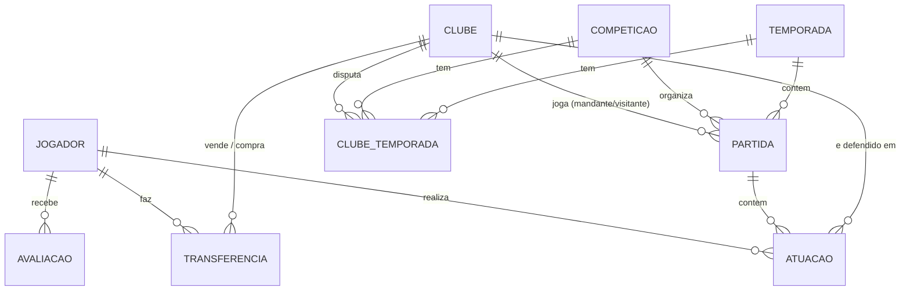
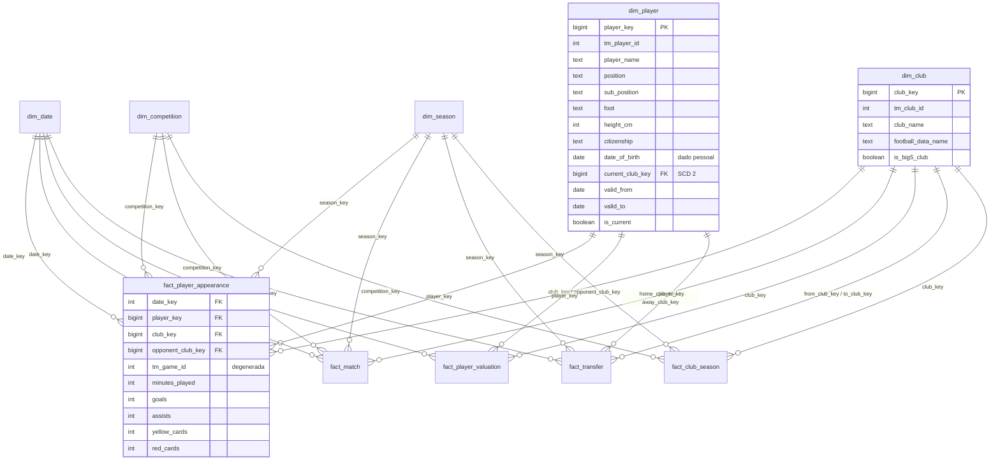

# Parte 2 — Modelagem do Data Warehouse

Modelo dimensional da parte 2, desenhado a partir do [profiling das fontes](profiling-fontes.md). A implementação será em **SQL puro no PostgreSQL**, sem dbt (o dbt entra na parte 3).

## 1. Requisitos

**Pergunta principal:** quanto vale a produção de um jogador de outra liga se ele for para a Premier League?

Perguntas que o modelo precisa responder:

| # | Pergunta | Precisa de |
|---|---|---|
| R1 | Quanto cada jogador produz por 90 minutos, por temporada e liga? | Atuações por jogo, com minutos |
| R2 | Qual era o clube e a liga do jogador em uma data qualquer? | Histórico de clubes; liga do clube em cada temporada |
| R3 | Como o valor de mercado do jogador evoluiu? | Avaliações ao longo do tempo |
| R4 | Quanto foi pago em cada transferência, de onde para onde? | Transferências com clube de origem e destino |
| R5 | A produção muda quando o jogador troca de liga? (fator de conversão) | R1 + R2, para jogadores com atuações em mais de uma liga |
| R6 | O valor de mercado está acima ou abaixo do esperado pela produção? | R1 + R3 |
| R7 | Qual a força do time do jogador em cada temporada? | Classificação e pontos do clube por temporada |
| R8 | Como foram as partidas (estatísticas e odds)? | Partidas das duas fontes, unificadas |
| R9 | Como foi o desempenho do jogador antes, durante e depois de passar pelas cinco ligas? | R1 + R2 em todas as ligas cobertas, com a cobertura de cada período explícita |

**Escopo dos dados:** tudo o que o Transfermarkt oferece, sem filtro de jogadores. As cinco grandes ligas continuam sendo a referência das análises e a Premier League, o destino. As demais ligas entram como mercados de origem e de saída.

| Nível de cobertura | Competições | Temporadas | O que existe |
|---|---|---|---|
| **Completa** | 14 ligas europeias: as cinco grandes, mais Holanda, Portugal, Bélgica, Turquia, Escócia, Grécia, Rússia, Ucrânia e Dinamarca; torneios da UEFA; copas nacionais | 2012-13 a 2025-26 | Partidas e atuações (minutos, gols, assistências, cartões) |
| **Só partidas** | 17 ligas, entre elas MLS, Arábia Saudita, Brasil, Argentina, México, Japão, Suíça e Áustria | 2024-25 e 2025-26 | Placar e classificação, sem atuações |
| **Só carreira** | Qualquer outro clube | Toda a carreira | Transferências e avaliações de mercado |

Além disso:

- Jogadores: todos os **50 mil** cadastrados; 29,5 mil têm atuações registradas.
- Partidas anteriores a 2012-13 (190, sem atuações) ficam de fora.
- Data de corte: 6/7/2026 (última atualização do Transfermarkt). Transferências com data posterior (520 registros, contratos já assinados para o futuro) ficam de fora.

## 2. Modelo conceitual

Processos de negócio (cada um vira uma tabela fato):

1. **Atuação:** um jogador jogou uma partida por um clube.
2. **Partida:** dois clubes se enfrentaram, com placar, estatísticas e odds.
3. **Avaliação:** o Transfermarkt atribuiu um valor de mercado a um jogador em uma data.
4. **Transferência:** um jogador saiu de um clube para outro.
5. **Clube na temporada:** o desempenho consolidado de um clube em uma liga e temporada.

## 3. Modelo lógico

### 3.1 Tabelas fato

| Fato | Grão (uma linha por...) | Tipo | Linhas (aprox.) | Medidas |
|---|---|---|---|---|
| `fact_player_appearance` | jogador × partida | Transacional | 1,9 milhão | minutos, gols, assistências, cartões amarelos e vermelhos (todas aditivas) |
| `fact_match` | partida | Transacional | 88,8 mil | gols (tempo final e intervalo), chutes, chutes no alvo, escanteios, faltas, cartões, público (aditivas); odds (não aditivas) |
| `fact_player_valuation` | jogador × data de avaliação | Snapshot irregular | 656 mil | valor de mercado em euros (**semiaditiva**: não soma no tempo) |
| `fact_transfer` | transferência (jogador, data, origem, destino) | Transacional | 175 mil | valor pago em euros, valor de mercado na data |
| `fact_club_season` | clube × liga × temporada | Agregada (derivada das partidas) | 3,9 mil | partidas, vitórias, empates, derrotas, gols pró e contra, pontos, posição final |

Detalhes de cada fato:

- **`fact_player_appearance`**
  - Chaves: data, temporada, competição, jogador (versão vigente na data), clube do jogador, clube adversário.
  - Dimensões degeneradas: `tm_game_id` (liga a atuação à partida) e `is_home`.
  - O clube vem da própria atuação, que é a fonte mais confiável para "por quem ele jogou neste jogo".
- **`fact_match`**
  - Chaves: data, temporada, competição, clube mandante, clube visitante (a mesma dimensão de clube em dois papéis).
  - Inclui todas as partidas do Transfermarkt: ligas, copas, torneios da UEFA e seleções.
  - Nas cinco grandes ligas, une as duas fontes: o Transfermarkt traz público, árbitro e formação; o Football-Data.co.uk traz estatísticas e odds. A ligação é por liga + data + clubes, via tabela de correspondência de clubes. Nas demais competições, as colunas de estatísticas e odds ficam vazias.
  - Odds mantidas: Bet365 (pré-jogo) e Pinnacle (pré-jogo e fechamento), presentes em todas as 70 temporadas-liga.
- **`fact_player_valuation`**
  - Chaves: data, jogador (versão vigente na data), clube na data da avaliação.
  - Somar valores de datas diferentes não faz sentido; o correto é pegar a última avaliação até uma data.
- **`fact_transfer`**
  - Chaves: data, temporada, jogador, clube de origem e clube de destino (dimensão de clube em dois papéis).
  - `fee_status` derivado: **pago** (valor > 0), **sem custo ou não informado** (valor = 0) e **não divulgado** (valor nulo). A fonte não separa empréstimos de transferências livres; isso fica declarado como limitação.
- **`fact_club_season`**
  - Calculada a partir das partidas de liga (31 ligas; nas 17 com cobertura "só partidas", apenas 2024-25 e 2025-26). Resolve um problema real das fontes: a liga gravada no cadastro de clubes é a **atual**, então um clube rebaixado aparece na liga errada no passado. Esta tabela diz em qual liga cada clube estava em cada temporada.
  - Também mede a força do time (pontos e posição), usada nas análises de produção.

### 3.2 Dimensões

| Dimensão | Grão | Chave natural | Tratamento de histórico | Origem |
|---|---|---|---|---|
| `dim_player` | versão do jogador | `tm_player_id` + vigência | **SCD tipo 2** no clube; tipo 1 nos demais atributos | Transfermarkt |
| `dim_club` | clube | `tm_club_id` | Tipo 1 | Transfermarkt + correspondência com o Football-Data.co.uk |
| `dim_competition` | liga | `tm_competition_id` | Tipo 1 (estática) | Referência mantida no projeto |
| `dim_season` | temporada | rótulo `2015-16` | Estática | Gerada |
| `dim_date` | dia | data | Estática | Gerada |

**`dim_player`**

| Atributo | Tipo de SCD | Observação |
|---|---|---|
| clube vigente (`current_club_key`) | **2** | Uma nova versão a cada troca de clube; `valid_from`, `valid_to`, `is_current` |
| nome, pé preferido, altura, posição e subposição | 1 | A fonte só traz o valor atual; não há histórico de posição |
| nacionalidade | 1 | Usada no recorte dos brasileiros |
| data de nascimento | 0 | **Dado pessoal**: mascarado para perfis de análise (ver governança) |
| cidade de nascimento, agente, fim de contrato | — | **Não carregados**: não são necessários às perguntas (minimização, princípio da LGPD) |

Como o histórico de clubes é reconstruído (ver decisão D3):

1. Junta todas as observações "jogador X estava no clube Y na data Z": transferências, atuações e avaliações.
2. Ordena por data e agrupa observações seguidas do mesmo clube em um **período no clube**.
3. O início de cada período é a data da transferência, quando ela existe; senão, a primeira observação no novo clube.
4. Cada período vira uma versão da `dim_player`.

**`dim_club`**

- Inclui os 796 clubes do cadastro e também os clubes que só aparecem em transferências (cerca de 17,5 mil clubes distintos no total). Para esses, só há código e nome.
- Membros especiais vindos da fonte: **Sem clube**, **Aposentado** e **Desconhecido**.
- Membro padrão `-1` (**Não informado**) para chaves ausentes.

**`dim_season`**

- Gerada de 1990-91 a 2026-27, porque as carreiras começam antes de 2012.
- Atributos: rótulo (`2015-16`), ano de início, código do Transfermarkt (`2015`), código do Football-Data.co.uk (`1516`), formato curto das transferências (`15/16`) e a marca `in_analysis_scope` (2012-13 a 2025-26).

**`dim_competition`**

- As 65 competições do Transfermarkt, com código (`GB1`), código do Football-Data.co.uk quando houver (`E0`), nome, país e tipo (liga, copa nacional, torneio internacional, seleções).
- **`competition_group`:** cinco grandes ligas, outra liga europeia, liga fora da Europa, copa nacional, torneio da UEFA, seleções.
- **`coverage_level`:** completa, só partidas (ver o escopo dos dados).
- Membro "Fora da cobertura" para clubes de competições que a fonte não acompanha.

**`dim_date`**

- De 1/1/1990 a 31/12/2027, com chave inteira `AAAAMMDD`, ano, mês, dia da semana e temporada do futebol europeu (agosto a julho).
- Usada em três papéis: data da partida, da avaliação e da transferência.

### 3.3 Matriz de barramento

| Fato | Data | Temporada | Competição | Jogador | Clube | Clube (2º papel) |
|---|:-:|:-:|:-:|:-:|:-:|:-:|
| `fact_player_appearance` | ✔ | ✔ | ✔ | ✔ | ✔ do jogador | ✔ adversário |
| `fact_match` | ✔ | ✔ | ✔ | | ✔ mandante | ✔ visitante |
| `fact_player_valuation` | ✔ | | | ✔ | ✔ na data | |
| `fact_transfer` | ✔ | ✔ | | ✔ | ✔ origem | ✔ destino |
| `fact_club_season` | | ✔ | ✔ | | ✔ | |

As dimensões são **conformadas**: a mesma `dim_club` e a mesma `dim_season` servem a todos os fatos, o que permite cruzar, por exemplo, transferências com o desempenho do clube na temporada.

## 4. Diagrama do modelo dimensional

## 5. Modelo físico (PostgreSQL)

**Camadas (schemas):**

| Schema | Conteúdo |
|---|---|
| `staging` | Cópia fiel das fontes, uma tabela por arquivo, sem transformação |
| `ref` | Dados de referência mantidos à mão e versionados no Git: correspondência de clubes entre fontes, códigos de competição |
| `dw` | Dimensões e fatos |
| `mart` | Visões de consumo: produtos de dados, Streamlit e agente de scouting |
| `audit` | Registro de cargas e de consultas |

O schema `ref` é novo em relação ao que foi criado na etapa 0.

**Convenções:**

- Nomes em inglês, `snake_case`, prefixos `dim_` e `fact_`.
- Chaves substitutas `bigint` geradas pelo banco; a chave natural da fonte é mantida com prefixo (`tm_player_id`).
- Chave de data inteira `AAAAMMDD`.
- Membro `-1` em toda dimensão para valores ausentes: nenhuma chave estrangeira nula nos fatos.
- Valores monetários em `numeric(14,0)`, em euros.
- Chaves estrangeiras declaradas no banco e índices nas chaves dos fatos.
- `COMMENT ON` em toda tabela e coluna: é a base do dicionário de dados.

**Carga:** Python lê os arquivos para `staging`; todo o resto é SQL. A ordem é referência → dimensões → fatos → marts, e cada execução grava uma linha em `audit`.

## 6. Decisões de modelagem

| # | Decisão | Alternativa descartada | Motivo |
|---|---|---|---|
| D1 | Esquema estrela | Floco de neve (posição, país e liga em tabelas próprias) | Poucas linhas nas dimensões; consultas mais simples para análise e para o agente |
| D2 | Todos os jogadores e competições da fonte, com o nível de cobertura explícito em cada competição | Só quem atuou nas cinco grandes ligas | A fonte cobre 14 ligas europeias por completo, que são justamente os mercados de onde a Premier League contrata. Sem elas, não há como medir o desempenho antes e depois de entrar ou sair das cinco ligas. O volume (1,9 milhão de atuações) é tranquilo para o PostgreSQL |
| D3 | Histórico de clubes reconstruído por transferências **+** atuações **+** avaliações | Só transferências | Entre os 10.596 jogadores com atuações nas cinco grandes ligas, 5.102 não têm nenhuma transferência registrada, e 34% das atuações não teriam clube histórico. Quando há transferência, ela concorda com o clube da atuação em 99,2% dos casos |
| D4 | O clube de cada atuação vem da própria atuação, não da `dim_player` | Usar o clube da versão vigente do jogador | A atuação é a evidência mais direta; a diferença entre as duas vira um teste de qualidade |
| D5 | Liga de cada clube por temporada em `fact_club_season`, derivada das partidas | Usar a liga do cadastro de clubes | O cadastro guarda a liga atual; clubes rebaixados apareceriam na liga errada no passado |
| D6 | Unificar Transfermarkt e Football-Data.co.uk em uma única `fact_match` | Duas tabelas de partida | O número de partidas bate nas 70 temporadas-liga; uma partida é um único evento de negócio |
| D7 | Correspondência de clubes mantida à mão em `ref` e testada | Correspondência automática por similaridade de nomes | A correspondência só é necessária nas cinco grandes ligas, onde há dados do Football-Data.co.uk: são 176 clubes. A revisão humana é barata e evita erros silenciosos. A parte 3 trata o caso difícil (jogadores) com regras e IA |
| D8 | Não carregar cidade de nascimento, agente e fim de contrato | Carregar tudo da fonte | Minimização de dados pessoais: só entra o que responde a uma pergunta |
| D9 | Transferências com data após o corte (6/7/2026) ficam de fora | Mantê-las | São contratos futuros, não fatos ocorridos |
| D10 | Eventos de jogo (gols e cartões com minuto) fora da parte 2 | Uma `fact_match_event` | Não respondem a nenhuma pergunta desta parte; eventos lance a lance chegam na parte 4 |

## 7. Produtos de dados (`mart`)

Visões construídas sobre os fatos, que geram informação que nenhuma tabela da fonte traz sozinha:

| Produto | Grão | Responde |
|---|---|---|
| `player_season_stats` | jogador × temporada × competição | Minutos, participação nos minutos possíveis, gols e assistências por 90 (R1) |
| `player_career` | jogador × período em um clube | Carreira reconstruída: clubes, ligas, minutos e valor de mercado ao longo do tempo (R2, R3) |
| `player_career_trajectory` | jogador × mudança de grupo de ligas | Desempenho antes e depois de entrar ou sair das cinco ligas (R9) |
| `league_conversion_factor` | liga de origem × posição | Quanto a produção numa liga equivale na Premier League (R5) |
| `player_value_gap` | jogador × temporada | Valor de mercado esperado pela produção contra o real (R6) |

### 7.1 Trajetórias de carreira

Classifica a carreira de cada jogador pela sequência de períodos **dentro** (cinco grandes ligas) e **fora** (outras ligas) e compara o desempenho em cada período.

**Regras:**

1. Para cada jogador e temporada, a **liga principal** é a liga com mais minutos, desde que tenha pelo menos **450 minutos** (cerca de cinco jogos completos). Temporadas abaixo disso não contam. O limite fica parametrizado.
2. Temporadas seguidas no mesmo grupo formam um período.
3. A sequência de períodos define o cenário.
4. Períodos em clubes sem cobertura de atuações (Brasil, MLS, Arábia Saudita etc.) aparecem na carreira só com clube e valor de mercado, marcados como **sem dados de partidas**.

**Cenários e amostra** (14 ligas com cobertura completa, 2012-13 a 2025-26):

| Cenário | Jogadores | Leitura para o scouting |
|---|---:|---|
| Fora → Dentro | 764 | A contratação clássica; base do fator de conversão |
| Dentro → Fora | 879 | Saída: fim de carreira, perda de espaço ou proposta financeira |
| Fora → Dentro → Fora | 324 | Não se firmou: o que esses jogadores tinham em comum antes de chegar? |
| Dentro → Fora → Dentro | 158 | Passo atrás para voltar, muitas vezes por empréstimo |
| Mais de três períodos | 112 | Analisados como sequência de mudanças |
| Sempre dentro / sempre fora | 5.166 / 11.110 | Grupos de comparação |

**Métricas por período:** participação nos minutos possíveis (métrica principal, vale para qualquer posição), gols e assistências por 90 (atacantes e meias), força do time (`fact_club_season`), idade e valor de mercado no início e no fim do período.

**Cuidados na interpretação:**

- **Idade:** quem sai das cinco ligas tende a ser mais velho; as comparações são feitas por faixa de idade.
- **Força do time:** produzir em um time grande de uma liga menor não equivale a produzir em um time médio da Premier League.
- **Viés de seleção:** só muda de liga quem foi considerado bom o bastante; o resultado descreve quem foi contratado, não o jogador médio da liga de origem.

## 8. Limitações conhecidas

- **Minutos até 90:** a fonte não conta acréscimos, o que subestima levemente os minutos e superestima a produção por 90.
- **Empréstimos:** a fonte não distingue empréstimo de transferência sem custo.
- **Posição única por jogador:** só existe a posição atual; um jogador que mudou de função ao longo da carreira aparece sempre na posição de hoje.
- **Cobertura de transferências cresce no tempo:** poucas antes de 2010, por isso o histórico de clubes depende das atuações e avaliações nos anos iniciais.
- **Dados faltantes:** 586 jogadores sem posição, cerca de 5,9 mil sem pé preferido, 49 sem data de nascimento.
- **Cobertura desigual entre ligas:** fora das 14 ligas europeias não há atuações, e nas 17 ligas com "só partidas" há apenas duas temporadas. Toda análise indica o nível de cobertura do período.

## 9. Próximos passos

1. Script de carga para `staging`.
2. Tabelas `ref`, com a correspondência de clubes.
3. DDL das dimensões e fatos, com comentários.
4. Transformações em SQL, incluindo o SCD tipo 2.
5. Testes de qualidade e plano de governança.
